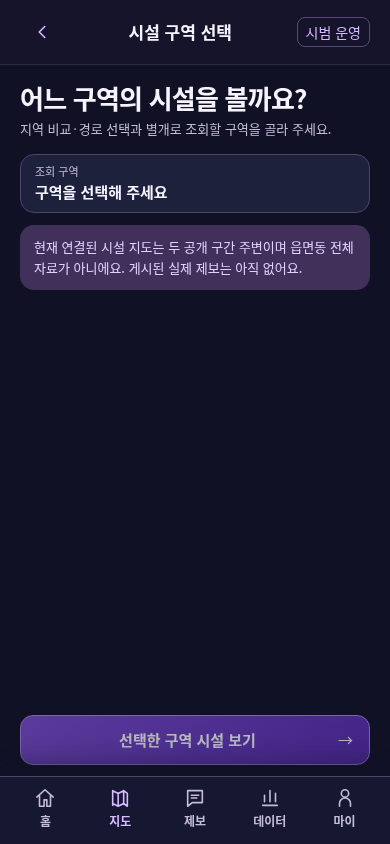
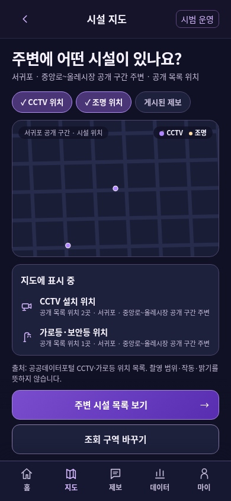

# 시설 화면의 독립 구역 선택

## 결론

시설 이슈 화면에서 먼저 조회할 구역을 고르게 바꿨습니다. 지역 비교에서 선택한 읍면동이나 직전에 비교한 경로를 조회 구역으로 자동 사용하지 않습니다.

기존 코드는 지역 비교 선택값을 직접 쓰지 않았습니다. 비교한 경로 주변 시설이 있으면 그것을 가져왔고, 없으면 연동 공개 구간 주변을 기본 조회했습니다. 이제 이 자동 선택을 제거했습니다.

## 사용하는 순서

1. 홈에서 ‘시설 이슈’를 누릅니다.
2. 조회 구역을 직접 고릅니다. 고르기 전에는 시설 조회를 요청하지 않습니다.
3. ‘선택한 구역 시설 보기’를 누르면 해당 구역의 CCTV·조명 공개 위치를 보여줍니다.
4. ‘조회 구역 바꾸기’로 돌아가 다른 구역을 고릅니다. 시설 목록에도 선택한 구역 이름을 표시합니다.



## 자료 범위

현재 연결한 시설 지도는 다음 **두 공개 구간 주변**입니다. 유동인구의 43개 읍면동 전체와 같은 범위가 아닙니다.

- 연동: 삼무공원~누웨마루 공개 구간 주변
- 서귀포: 중앙로~올레시장 공개 구간 주변

읍면동 전체 시설이나 제주 전체의 게시 제보를 조회하는 기능을 구현한 것은 아닙니다. 공개 목록의 위치는 CCTV 촬영 범위·현재 작동·조명 밝기를 보장하지 않습니다. 시설 수는 표시 자료에 포함된 설치 지점 수이며 실제 구역의 시설 전체 수를 뜻하지 않습니다.

**현재 게시된 실제 제보는 없습니다.** 시설 위치와 실제 이슈를 구분하며, 기존 처리 흐름 예시는 선택 구역과 무관한 예시라고 명시했습니다. 이를 선택 구역의 실제 소등·고장으로 표시하지 않습니다. 전 지역 확대에는 구역 경계와 시설 위치의 대응, 게시 제보 저장·승인 연결이 필요합니다.



## 전환·실패 처리

구역을 바꾸면 기존 표시와 개수를 지우고, 이전 구역의 늦은 응답은 무시합니다. 자료 요청이 실패하면 불러오지 못했다고 표시하고 다른 구역이나 이전 시설 자료로 대체하지 않습니다. 정상 응답이지만 목록이 비었을 때는 표시 목록 0곳으로 갱신해 이전 개수를 남기지 않습니다. 화면 진입·초기화에서 조회 버튼 상태도 다시 확인합니다.

## 검사와 남은 확인

2026-11-20 08:18 한국 시간: 브라우저 제외 자동334개 통과, 기존 의존성 경고1건. Chromium390·768·1280px에서 지역 비교와 독립된 초기 선택, 선택 전 요청0, 지정 구역 요청, 시설 종류·개수, 목록 이동, 빠른 구역 변경의 늦은 응답 폐기, 실패 시 대체 금지, 빈 목록의 이전 개수 제거를 확인했습니다. 넘침·자바스크립트 오류·외부 요청0입니다. 선택 화면과 지도 화면을 직접 열어 확인했습니다.

지도 점과 개수 검사는 합성 응답입니다. 실제 구역의 최신 시설 수·실제 게시 제보·실제 휴대폰 검증은 아닙니다. 재현 명령은 저장소 루트에서 아래와 같습니다. 이 검사는 설치된 Playwright와 `/usr/bin/chromium`이 있는 Pi 환경 기준입니다.

```sh
.venv/bin/python tests/browser/run_facility_region_smoke.py
```

기존 지역 선택·두 지역 상세 변경과 같은 `fix/population-options` 브랜치입니다. 담당자의 병합·실제 배포 확인은 아직 남아 있습니다. 제출 브랜치·예비 버전 직접 변경은 없습니다.
