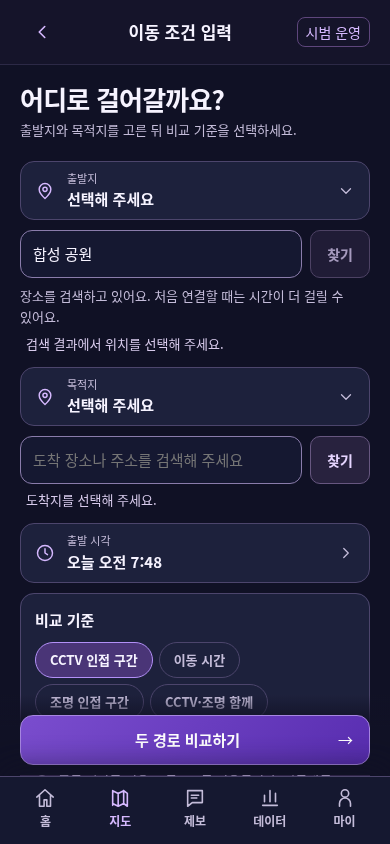

# 첫 접속 지연 확인과 준비 확인 추가

## 결론

첫 검색이 약 12초였다는 관측은 이번에 재현되지 않았습니다. 서버 시작, 네트워크, 장소 제공사 중 하나를 원인으로 확정할 근거가 부족합니다. **속도가 12초에서 줄었다고 검증한 상태는 아닙니다.** 페이지 진입 후 준비 확인을 한 번 병렬로 실행하고, 검색 중 안내와 시간 계측을 추가했습니다. 배포 전 검토 브랜치입니다.

## 적용 내용과 다음 확인

- 페이지당 `/health` 준비 확인을 한 번만 실행합니다. 화면과 장소 검색은 완료를 기다리지 않습니다. 준비 확인은 5초 후 취소하며 실패해도 검색을 막지 않습니다. 페이지 이탈 시 취소합니다.
- 준비 확인에는 검색어·주소·키·위치를 보내지 않고, 외부 지도 제공사를 호출하지 않습니다. 검색 기록과 결과 캐시, 반복 호출 예약은 추가하지 않았습니다.
- 장소 검색을 누르면 즉시 검색 중 안내를 표시합니다. 제공사 응답 제한 시간은 기존 12초를 유지합니다. 제한 시간을 줄여 빨라진 것처럼 처리하지 않습니다.
- 장소 검색 응답의 `Server-Timing` 헤더는 `search`(검색 함수 시간: 연결 준비·제공사 대기·응답 처리 포함), `handler`(처리 함수 시간: 검색 모듈 불러오기 포함), `init`(해당 프로세스의 최초 API 모듈 준비 시간)을 밀리초로 표시합니다. `init`는 요청마다 반복된 시간이나 Vercel 전체 시작 시간이 아닙니다. 오류에도 숫자만 표시하며 주소·검색어·키를 로그에 남기지 않습니다.
- 병합 후 배포에서 오래 쉬었다가 접속하는 조건으로 다시 측정해야 합니다. 브라우저 개발자 도구의 전체 대기 시간과 헤더를 비교합니다. 전체 대기는 긴데 handler가 짧으면 서버 호출 전 대기나 네트워크도 살펴야 합니다. search가 길면 제공사 연결·응답을 추가 조사합니다.
- `/app` 자체도 같은 FastAPI 앱이 제공합니다. 페이지를 열 때 이미 서버가 시작됐을 수 있으며, 준비 요청이 다른 인스턴스에 도착할 수도 있어 지속 실행이나 지연 감소를 보장하지 않습니다.

## 확인한 결과 (2026-11-20 07:45~07:49 한국 시간)

| 검사 | 결과 | 한계 |
|---|---|---|
| Pi에서 새 Python 프로세스로 앱 불러오기 3회 | 0.380·0.385·0.381초, 최대 메모리 약 47MiB | Vercel 서버 시작을 재현한 검사 아님 |
| 읽기 전용 병렬 조사 | API 준비 0.450초, 검색 모듈 추가 준비 0.038초, HTTP 클라이언트 생성·종료 0.029초 | 실제 네트워크 대기 미포함 |
| 기존 배포 `/health` | 0.102초, HTTP 200 | 먼저 확인한 요청이어서 이후 서버를 깨웠을 수 있음 |
| 기존 배포의 같은 공개 장소 검색 2회 | 0.420·0.218초, 모두 HTTP 200 | 이미 실행 중인 서버의 관측, 수정 후 성능 측정 아님 |
| 자동 검사 | 브라우저 제외 336개 통과, 기존 의존성 경고 1건 | 이번 브랜치 기준; 별도 제보 점수 브랜치 검사 수와 다름 |
| Chromium 390px, 준비 응답 3초·검색 응답 0.5초 대역 | 준비 중 검색 조작·안내 표시 성공, 준비 요청 1회, 가로 넘침·자바스크립트 오류·외부 요청 0 | PC에서 화면 폭 재현, 실제 휴대폰 아님 |
| 로컬 명령 검사 | 한 번만 요청, 실패 격리, 취소·시간 제한, 숫자 계측·정적 파일 제공 통과 | 실제 서버 시작 지연 개선의 증거는 아님 |

아래는 합성 검색과 느린 준비 응답으로 확인한 화면입니다.

## 후속 개선 후보

1. 서버 시작 비중이 크면 실행 환경과 배포 묶음 크기를 확인합니다. 서버 상시 실행 또는 유료 요금제는 별도 비용 결정이 필요합니다.
2. 제공사 연결 비중이 크면 연결 재사용을 검토합니다. 오래된 연결, 동시 요청, 제공사 쿠키 보존 금지를 검사해야 합니다. 매 요청 HTTP 클라이언트를 만드는 현행 구조는 후속 요청의 연결 재사용을 못하지만, 이를 바꾸는 것만으로 최초 지연이 해결되지는 않습니다.
3. 시연에서는 기존처럼 2~3분 전 공개 장소를 한 번 검색합니다. 입력 후보의 장소명·주소도 직접 확인합니다.

추천 계산·개인 위치 보관 정책·모델 사용·호스팅 요금은 변경하지 않았습니다. 제출 전 병합과 실제 배포 확인은 담당자가 진행합니다.
