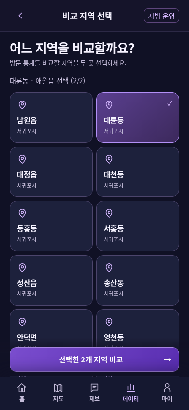

# 유동인구 조회 항목과 지역 선택 정리

## 결론

시간대별 자료가 없어 표시만 했던 ‘시간대별 · 자료 없음’ 항목을 제거했습니다. 현재 조회는 월별입니다. ‘추후 자료를 확보하면 옵션이 열린다’는 안내는 현재 월별·비실시간 자료라는 설명으로 바꿨습니다. 출처·기준일·시간대 자료 없음이라는 사실 안내는 남겼습니다.

지역 비교는 시범 운영으로 연동·노형동만 허용한 것이 아닙니다. 43개 읍면동 목록을 쓰고 있었으나, 연동과 노형동 두 곳을 미리 체크해 최대 두 곳 제한을 채운 상태였습니다. 이때 세 번째 항목을 누르면 설명 없이 선택을 취소하는 코드 때문에 다른 지역을 고를 수 없는 것처럼 보였습니다.

## 바뀐 사용 방법

- 처음에는 아무 지역도 선택하지 않습니다. 목록에서 직접 두 곳을 고릅니다.
- 선택 이름과 개수를 표시하며, 두 곳이 되었을 때 비교 버튼이 켜집니다.
- 세 번째를 누르면 ‘선택한 곳 하나를 먼저 해제해 주세요’라고 안내합니다. 기존 두 곳을 임의로 바꾸지 않습니다.
- 다른 지역으로 바꾸려면 한 곳을 해제한 뒤 새 지역을 고릅니다.

## 확인한 범위

제주데이터허브 월별 파생 자료 `data/population/jeju_emd_population_monthly.json`의 목록은 **43개 읍면동, 53개 월(2017-01~2021-05)**입니다. 현재·시간대별 인구를 뜻하지 않습니다. 실제 사람 수와 자료의 집계값도 구분해야 하며 기존 단위 안내는 유지했습니다.

2026-11-20 08:05 한국 시간: 브라우저 제외 자동334개 통과, 기존 의존성 경고1건. Chromium390·768·1280px에서 실제 저장된 공개 월별 자료를 읽어 43개 목록·초기0개·두곳선택·세번째거부안내·해제후변경·대륜동/애월읍 비교막대2개를 확인했습니다. 가로 넘침·자바스크립트 오류·외부 요청0입니다. 모든 지역쌍의 수치 정확도나 실제 휴대폰을 검증한 것은 아닙니다. 공유 검사·공백 검사도 통과했습니다.

수정 브랜치 `fix/population-options`이며 제출 브랜치 병합과 배포 확인은 아직 하지 않았습니다. 앞서 작성한 경로 기준·추천 이유·시작 준비 변경과 독립된 작은 수정입니다. 담당자가 병합 후 배포에서 지역 선택을 다시 확인해야 합니다.
