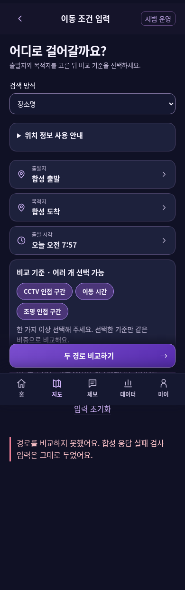
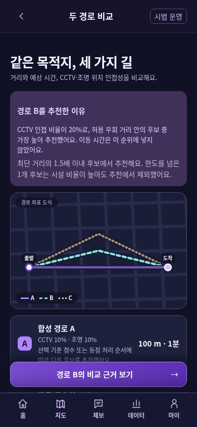

# 이동 조건의 복수 기준 선택

## 결론

‘CCTV·조명 함께’ 항목을 없애고 **CCTV 인접 구간·이동 시간·조명 인접 구간** 세 가지를 각각 체크하도록 바꿨습니다. 한 가지 이상 선택할 수 있습니다. 검색 방식은 출발지 입력 위로 옮기고, 위치 사용 정책은 별도 펼침 안내로 분리했습니다. 배포 전 검토 브랜치입니다.

## 사용 방법

1. 검색 방식(장소명·도로명·지번)을 고릅니다. 기본은 장소명입니다.
2. 출발지·목적지를 검색해 후보에서 직접 선택합니다.
3. 출발 날짜·시각을 확인합니다.
4. 비교 기준을 한 가지 이상 선택합니다. 세 가지를 모두 선택해도 됩니다.
5. 경로 비교 버튼을 누릅니다. 기준이 비어 있으면 계산 전에 안내합니다.

화면의 기본 체크는 기존처럼 CCTV입니다. 초기화하면 기본 체크로 돌아갑니다. 위치 정보 안내를 동의 체크나 추가 작성 단계로 만들지 않았습니다. 개인정보 보관·외부 전송 정책은 그대로입니다.

## 계산 방법과 변경 범위

직접 고른 기준만 같은 비중으로 비교합니다. 이는 복수 선택을 처리하기 위한 구현 방식이며 실제 안전성이나 이용자 선호로 검증한 가중치는 아닙니다. 화면에도 ‘선택한 기준만 같은 비중’이라고 표시합니다.

- 이동 시간 값 = 우회 한도 안에서 가장 빠른 후보의 예상 시간 ÷ 해당 후보 예상 시간
- CCTV 값 = CCTV 인접 길이 비율
- 조명 값 = 조명 인접 길이 비율
- 선택 기준 점수 = 선택한 값의 평균 × 100. 높은 후보를 추천합니다.

예를 들어 가장 빠른 후보가 10분이고 다른 후보가 15분·CCTV 인접 90%라면, 이동 시간과 CCTV를 선택했을 때 다른 후보의 값은 `(10/15 + 0.9) / 2 × 100 = 약 78.9`입니다. 선택하지 않은 조명 수치는 순위에 쓰지 않습니다. 동점은 짧은 거리, 경로 식별자 순으로 정합니다. 기존 우회 한도는 유지하며 이를 넘는 후보는 추천하지 않습니다. 최대 세 제공사 옵션을 받아 비교하며, 더 안전한 새 도로를 생성하거나 안전 확률을 계산한 것이 아닙니다.

새 화면은 `criteria` 목록을 서버에 보냅니다. 기존 `preference` 단일 요청은 그대로 동작합니다. 새 목록이 있으면 `criteria_score`와 `selected_criteria`를 기준으로 추천하며, 기존 `comparison_cost`는 참고 값으로 남고 새 순위에는 사용하지 않는다고 응답 설정에 표시합니다. 추천 이유에도 선택한 항목과 같은 비중 계산을 설명합니다. 새 화면에서 단일 체크를 한 경우에도 새 점수 방식을 쓰므로 기존 거리·시설 비용식과 순위가 달라질 수 있습니다. 병합 후 시연 구간을 다시 확인해야 합니다.

## 확인 범위

손계산과 미선택 기준 불변성, 가능한 7조합, 우회 한도·동점·잘못된 선택·API 전달·선택 경로 계산 연결을 자동 검사합니다. Chromium에서 390·768·1280px 화면별로 7조합 요청, 빈 선택 차단, 검색 방식 위치, 입력 보존, 가로 넘침 없음, 자바스크립트 오류 0·외부 요청 0을 확인했습니다. 합성 검색과 경로 실패 응답을 사용했으며 실제 휴대폰·실제 제공사 경로 결과 검사는 아닙니다.

별도 제보 점수 후보·첫 접속 준비 확인 브랜치는 이 브랜치에 합치지 않았습니다. 아침 인수 규칙에 따라 담당자가 검토·병합하고 배포에서 실제 경로를 확인해야 합니다.

2026-11-20 07:58 한국 시간: 브라우저 제외 전체 351개 통과(이번 기능 17개 포함), 기존 의존성 경고 1건. 스테이징 8파일 공유 검사·변경 공백 검사 통과.

## CCTV를 골랐는데 비율이 낮은 길이 추천되는 문제 (08:02 보완)

기존 배포의 거리·시설 비용식에서는 CCTV 비율만으로 순위를 정하지 않았습니다. 예를 들어 A 100m·CCTV 10%, B 120m·CCTV 20%라면 CCTV 가중치 4에서 기존 비용은 A 460, B 504여서 A를 고릅니다. 이는 전달받은 실제 경로의 입력을 재현한 결과가 아니라, 현상이 발생할 수 있음을 보이는 합성 손계산입니다.

이 브랜치의 새 화면에서는 CCTV만 체크하면 **허용 우회 거리 안에서 CCTV 인접 비율이 가장 높은 후보**를 고릅니다. 위 합성 사례에서는 B를 고릅니다. 이동 시간·조명 수치는 CCTV 단독 순위에 넣지 않습니다. CCTV 비율이 같으면 짧은 거리를 먼저 고르고, 거리도 같으면 경로 식별자 순으로 정합니다.

추천 이유를 결과 상단에 표시하고, 후보마다 추천·제외 이유를 적습니다. 입력 화면에도 최단 거리의 1.5배 이내에서 추천한다는 제한을 드러냈습니다. 비율이 더 높은 후보여도 이 한도를 넘으면 제외됐다고 설명합니다. 서로 다른 경로가 한 개뿐이면 다른 길보다 우수하다고 비교한 결과가 아니라는 안내를 냅니다. 복수 선택의 비교 점수와 계산식·비중 안내도 실제 새 계산에 맞췄습니다.

08:02 검사: 자동 **354개 통과**, 기존 의존성 경고 1건. 추가 3검사는 짧은 길보다 CCTV 비율 우선, 우회 한도 제외 설명, 후보 한 개·동점 안내입니다. Chromium 390·768·1280px에서 합성 A(10%)·B(20%)·C(90%, 우회 한도 초과)를 받아 B 추천 표시·C 제외 이유·상단 추천 근거·새 계산식 표시를 확인했습니다. 넘침·자바스크립트 오류·외부 요청 0입니다. 실제 휴대폰과 사용자가 보고한 원래 경로의 재현은 아닙니다. 병합·배포는 아직 하지 않았습니다.
