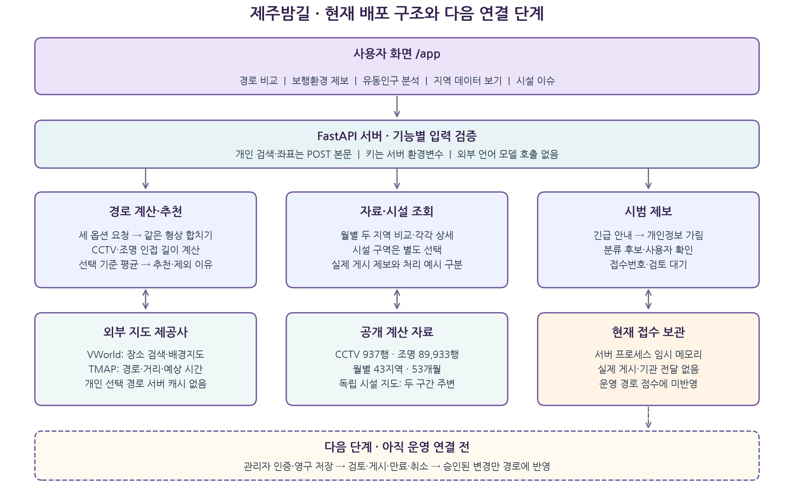

# 제주밤길 기술 기획서

2026년 11월 20일 아침 수정 반영본 · 기준: `feature/service-screens`의 배포된 서비스

서비스: https://jeju-night-team.vercel.app/app · 확인용 화면: `/lab` · [PDF 내려받기](pdf/SERVICE_PLAN.pdf)

## 결론

**제주밤길은 보행 경로 후보의 예상 시간과 공개 CCTV·조명 인접 비율을 비교하는 웹 서비스입니다.** 장소를 직접 선택하고 비교 기준을 체크하면, 선택한 기준에 따른 추천 이유와 제외 이유를 보여줍니다. 지역별 월별 방문 규모 조회와 시설 구역 조회는 각각의 메뉴로 제공합니다.

운영 에이전트는 **규칙·계산 코드·문장 틀**로 동작합니다. 외부 언어 모델을 호출하지 않습니다. 거리·시간·시설 비율은 모델이 생성하지 않습니다. 시설의 작동·밝기·촬영 범위·현장 통행·안전을 보장하지 않습니다.

| 구분 | 현재 상태 |
|---|---|
| 배포에서 확인 | 장소 검색, 보행 후보 비교, 선택 기준 추천·이유, 배경지도, 월별 지역 비교·양쪽 상세, 독립 시설 구역 선택, 제보 접수·긴급 안내 |
| 자료·범위 제한 | 고유 경로는 1~3개. 유동인구는 과거 월별 집계. 독립 시설 지도는 두 공개 구간 주변 |
| 예시만 제공 | 게시된 시설 변경, 검증 후 경로 재분석, 내 제보의 게시 완료 예시 |
| 아직 미연결 | 관리자 승인 화면, 제보 영구 저장, 실제 게시 제보 조회, 승인 제보의 운영 경로 반영 |
| 별도 확인 필요 | 실제 휴대폰·센터 기기, 현장 통행, 처음 접속할 때의 지연, 추천 기준에 대한 사람 평가 |

## 1. 다음에 할 일과 사람의 판단

| 우선순위 | 할 일 | 먼저 결정·확인할 것 |
|---|---|---|
| 제출 전 | 실제 휴대폰 리허설·캡처·최종 문서와 기능 대조 | 사람이 직접 사용해 보고 제출물을 확정. 자동 검사로 대신하지 않음 |
| 추천 기준 검토 | 현재의 같은 비중·CCTV 50m·조명 15m·거리 상한 1.5배 평가 | 비율·거리·시간 중 무엇을 더 중요하게 볼지. 현재 값은 안전 기준으로 검증한 값이 아님 |
| 제보 운영 | 영구 저장 → 관리자 인증 → 검토·게시 → 해제·만료 → 경로 반영 | 반영 대상, 검증 근거, 반경·강도·유효기간, 잘못된 승인 취소 방법 |
| 시설 지역 확대 | 행정구역 경계와 시설 좌표를 대응시켜 조회 범위 확대 | 구간 주변과 읍면동 전체를 혼동하지 않도록 경계·좌표 품질·이용 조건 확인 |
| 사용성 평가 | 서로 다른 경로 후보와 근거를 보여 주고 선택 이유 수집 | 4명·30문항 계획은 아직 수행 전. 소수 응답으로 제주 이용자 전체의 선호를 확정하지 않음 |

기존 계산기를 교체하는 것보다 **자료 범위·검토 권한·추천 기준의 검증**이 더 필요한 단계입니다. 제보가 접수됐다는 사실만으로 점수를 바꾸지 않습니다. 승인 제보 주변 길이에 추가 비용을 주는 별도 비교 모듈과 반경·강도 후보는 작성했지만, 현재 배포 추천에는 적용하지 않았습니다.

## 2. 사용자 화면과 흐름

홈의 메뉴는 경로 비교·보행환경 제보·유동인구 분석·지역 데이터 보기·시설 이슈입니다. 지역 비교로 중복 연결되던 ‘제주, 어디를 걸을까요?’ 큰 카드는 제거했습니다.

| 메뉴 | 사용 순서 | 현재 제공 결과 |
|---|---|---|
| 경로 비교 | 검색 방식 → 출발지·목적지 후보 직접 선택 → 날짜·시각 → 비교 기준 1~3개 체크 | 고유 경로별 거리·예상 시간·CCTV/조명 인접 비율, 추천·제외 이유, 지도 |
| 보행환경 제보 | 위치 → 시설·문제 → 설명 → 확인·동의 → 접수 | 분류 후보·개인정보 가림·접수번호·검토 대기. 실제 민원 전달과 경로 반영은 없음 |
| 유동인구 분석 | 월·지역 범위·집계 단위 선택 | 과거 월별 집계의 분포와 출처. 자료 없는 시간대별 선택 항목은 제거 |
| 지역 데이터 보기 | 43개 읍면동 중 두 곳을 직접 선택 → 기준 월 → 비교 | 두 지역 비교, 각각의 상세 버튼, 선택 월까지 최대 12개월의 해당 지역 자료 |
| 시설 이슈 | 조회 구역을 별도로 선택 → 시설 지도·목록 | 연동 또는 서귀포 공개 구간 주변의 CCTV·조명 위치. 다른 화면의 지역·경로를 자동 사용하지 않음 |

지역 비교는 처음에 아무 지역도 선택하지 않습니다. 두 곳 제한에 도달했을 때 다른 곳을 누르면 기존 선택을 먼저 해제하라고 안내합니다. 시설 화면의 처리 흐름 예시는 선택 구역의 실제 고장 제보와 구분합니다.

## 3. 서비스 구조

그림의 실선은 현재 연결, 점선은 다음 단계입니다. 사용자용 입력 화면은 목적이 정해진 서버 기능을 직접 호출합니다. 모든 화면 입력이 자연어 의도 분류를 거치는 구조는 아닙니다. `/lab`의 문장 대화·합성 시연은 사용자 화면과 분리했습니다.

| 모듈 | 역할 | 교체·확장 시 유지할 계약 |
|---|---|---|
| `client/nightway` | 화면·페이지 상태·사용자 확인·요청 취소 | 화면을 떠난 뒤 이전 위치·응답을 새 결과에 쓰지 않음 |
| `agent/api.py` | FastAPI 입력 검증·기능별 요청·안전한 오류 응답 | 검색·선택 좌표는 POST 본문. 오류에 키·개인 입력을 되돌리지 않음 |
| `agent/maps/search.py` | VWorld 장소명·도로명·지번 검색 | 제주 범위 후보를 보여 주고 사용자가 확정 |
| `agent/data/tmap_routes.py` | TMAP 보행 3옵션과 시설 인접 비율 | 같은 형상 합치기, 실패·자료 없음 구분, 후보를 임의로 만들어 채우지 않음 |
| `agent/data/selected_routes.py` | 선택 위치·시각 확인, 일회성 경로 계산 | 개인 선택 요청·경로를 서버 파일·데이터베이스·캐시에 저장하지 않음 |
| `agent/data/route_criteria.py` | 선택 기준만 점수 계산, 추천·제외 이유 | 미선택 기준을 점수에 넣지 않음. 기준 변경을 독립 모듈에서 처리 |
| `agent/geometry.py` | 시설 반경과 경로의 겹친 길이 계산 | 겹친 구간을 중복 가산하지 않음 |
| `agent/report`, `stubs/reports.py` | 긴급 검사·분류·개인정보 가림·시범 접수 | 자동 분류와 사람 검증을 구분. 운영 관리자 권한을 대신하지 않음 |
| `agent/explain`, 화면 문장 틀 | 계산된 숫자와 출처 설명 | 계산값을 지어내거나 안전 확률로 바꾸지 않음 |
| `agent/llm` | 언어 모델 연결 실험용 부품 | 현재 운영 흐름에 연결하지 않음. 향후에도 개인 위치 전송·숫자 계산과 분리 |

## 4. 경로 후보와 추천 계산

### 4.1 후보 생성·자료 결합

VWorld로 검색한 제주 위치를 사용자가 선택하면 TMAP의 최단·대로 우선·계단 제외 세 옵션을 요청합니다. 같은 형상은 하나로 합칩니다. **항상 서로 다른 세 길을 제공하는 것은 아닙니다.** 모두 실패하면 자료를 확인하지 못했다고 안내하며 합성 길로 대체하지 않습니다. 현재 선택 위치는 제주 범위의 직선거리 5m~20km를 지원합니다.

제공사의 거리·예상 시간과, 반환된 경로 형상에서 직접 계산한 시설 비율을 구분합니다. 날짜·오전/오후를 포함한 시각은 입력 조건으로 확인하지만 시간대별 밝기·보행량·시설 상태는 계산하지 않습니다.

### 4.2 시설 인접 비율

**시설 인접 비율 = 시설 반경 원들의 합집합과 겹치는 경로 길이 ÷ 전체 경로 형상 길이**

현재 비교 반경은 CCTV 50m, 조명 15m입니다. 실제 촬영·조명 도달 범위를 뜻하지 않습니다. 같은 구간에 시설이 여러 개 있어도 겹친 길이는 한 번만 셉니다. 좌표의 평면 근사를 사용하는 계산이며, 담장·건물 가림·카메라 방향·필지 각도를 반영하지 않습니다.

### 4.3 새 사용자 화면의 추천식

먼저 **제공사 최단 거리의 1.5배 이내** 후보만 추천 대상으로 둡니다. 이 제한은 시간이 아니라 거리 기준입니다. 그중 선택한 값만 같은 비중으로 평균합니다.

| 기준 | 0~1로 환산한 값 |
|---|---|
| 이동 시간 | 적격 후보 중 가장 빠른 예상 시간 ÷ 해당 후보 예상 시간 |
| CCTV | CCTV 인접 길이 비율 |
| 조명 | 조명 인접 길이 비율 |

**선택 기준 점수 = 선택한 값의 합 ÷ 선택한 기준 수 × 100**

점수가 높은 후보를 추천합니다. 동점이면 짧은 거리를 먼저, 거리도 같으면 경로 식별자 순으로 정합니다. 체크한 순서는 가중치 순서가 아닙니다. 여러 항목을 고르면 모두 같은 비중입니다. 사용자별 가중치 학습은 아직 없습니다.

- CCTV만 선택: 거리 상한 안에서 CCTV 인접 비율이 가장 높은 후보를 추천합니다. 시간·조명은 점수에 넣지 않습니다.
- 이동 시간만 선택: 거리 상한 안에서 예상 시간이 가장 짧은 후보를 추천합니다.
- CCTV와 이동 시간 선택: 두 값을 평균합니다. 가장 빠른 적격 후보가 10분이고 다른 후보가 15분·CCTV 90%라면 다른 후보 점수는 `(10/15 + 0.9) / 2 × 100 ≈ 78.9`입니다.
- 시설 비율이 더 높아도 거리 상한을 넘으면 제외 이유를 표시합니다. 후보가 한 개뿐이면 다른 길보다 우수하다고 비교한 결과가 아니라고 설명합니다.

기존 단일 `preference` 요청의 거리·시설 비용식은 호환을 위해 남겼습니다. **새 사용자 화면은 `criteria` 목록과 위 점수식을 사용합니다.** 예전 비용값은 새 화면의 추천 순위에 쓰지 않습니다. 선택 점수는 안전 점수·사고 확률이 아닙니다.

## 5. 데이터 확보·정리·예상 결과

공개 원본을 저장소의 `data/open`에 보관하고, 출처·기준일·제외 행과 좌표 오류를 확인합니다. 배포 빌드는 경로 구간별 계산 자료 네 개와 제주 시설 계산 자료 한 개를 만들며, 서버 실행물에서는 공개 원본을 제외합니다. 검사한 파생 자료 크기는 약 4.27MB입니다.

| 자료 | 확보·정리 결과 | 사용하는 곳과 한계 |
|---|---|---|
| 공공데이터포털 표준 CCTV | 원본 1,043행 중 생활방범·교통단속·어린이보호·시설물관리 937행 | 경로 인접 비율. 행 수는 카메라 대수나 고유 위치 수로 단정하지 않음 |
| 제주데이터허브 CCTV 대체 자료 | 원본 479행 중 네 목적 473행, 표준과 합치지 않고 대체 선택 | 기준일 2022~2024 혼재, 이용 조건 추가 확인 필요 |
| 제주시 가로등 | 52,019행 중 52,014행, 위도·경도 교환 16,155행 수정 사본 | 원본 보존·대조. 기준일 2024-10-10, 현재 밝기 아님 |
| 서귀포시 가로등·보안등 | 38,022행 중 37,919행, 빈 좌표 등 제외 | 기준일 2025-07-25. 두 시 조명 계산 자료 합계 89,933행 |
| 제주데이터허브 월별 인구 집계 | 43개 읍면동·53개월, 2017-01~2021-05 | 월별 거주·근무·방문 규모 비교. 경로 점수에는 사용하지 않음 |
| TMAP 보행자 경로안내 | 요청한 세 옵션의 형상·거리·예상 시간 | 실제 통행·폐쇄·안전을 확인한 결과는 아님 |
| VWorld 검색·배경지도 | 장소 후보·주소·지도 타일을 서버 중계 | 랜드마크보다 편의점이 먼저 나올 수 있어 사용자가 후보 확인 |
| OpenStreetMap 도로망 | 공개 구간 두 곳의 수집 자료 | 확인용 화면의 별도 탐색. 제주 전체 보행 도로망은 아님 |

월별 집계의 단위는 **매시 정각에 측정한 인구(머문 시간/60분)를 한 달 동안 더한 값**입니다. 고유 사람 수(명)나 시간대·야간 인구가 아닙니다. 월별 조회와 두 지역 비교·해당 지역의 과거 추세까지 예상할 수 있고, 특정 길의 현재 혼잡이나 야간 보행량을 알 수는 없습니다. 원자료 이용 조건의 미확인을 이용 허가 완료로 표현하지 않습니다.

독립 시설 지도는 **연동 삼무공원~누웨마루, 서귀포 중앙로~올레시장 공개 구간 주변**만 연결했습니다. 읍면동 전체 시설 조회가 아닙니다. 경로 비교의 선택 좌표 계산 범위와 독립 시설 메뉴의 조회 범위도 다릅니다. [자료 출처·파일 목록](../data/open/README.md).

## 6. 제보 처리와 운영 규칙

1. 긴급 위험 표현을 먼저 검사하고 해당하면 112·119 직접 신고 안내를 우선합니다. 서비스를 통해 신고가 접수됐다고 표현하지 않습니다. 모든 위험 표현을 인식한다고 보장하지 않습니다.
2. 제보 설명의 전화번호·이메일·주민등록번호 형식 등을 가리고 시설·문제 분류 후보를 제시합니다. 사용자 선택과 다르거나 모호하면 확인을 요청합니다.
3. 사용자가 위치·내용·동의를 확인하면 접수번호와 검토 대기를 표시합니다. 기관에 전달하지 않습니다.
4. 현재 서버 접수는 프로세스 임시 메모리이며 재시작 시 사라집니다. 페이지의 내 제보 목록도 영구 보관이 아닙니다. 페이지를 닫았다고 서버의 접수 기록까지 즉시 지워지는 구조로 설명하지 않습니다.
5. 접수된 제보는 **현재 경로 분석에 반영하지 않습니다.** 실제 게시 제보는 없고, 검증·게시·재분석의 예시와 대역 코드를 운영 기능으로 취급하지 않습니다.

다음 단계에는 인증된 검토자, 영구 저장, 근거·시각·유효기간·해결 상태, 취소·복구 이력이 필요합니다. 제보 주변 인접 길이 추가 비용, 고장 시설 제외, 폐쇄 도로 제외는 서로 다른 반영 방식이므로 선택 후 적용해야 합니다.

## 7. 개인정보·보안·오류 처리

| 항목 | 현재 처리 |
|---|---|
| 길찾기 위치 | 화면 변수에 보관. 화면 이동·초기화·페이지 종료 시 삭제. 선택 요청·경로를 앱 서버 파일·데이터베이스·캐시에 저장하지 않음 |
| 외부 전달 | 검색어는 VWorld, 선택 좌표는 TMAP에 전달. 외부 제공사의 처리·로그 정책은 별도이며 앱이 보관하지 않는다는 설명과 구분 |
| 전송·캐시 | 개인 검색·좌표는 POST 본문, 선택 경로 응답은 캐시 금지. 공개 월별 통계·고정 구간 자료의 캐시는 별도 |
| 키 | 실행 서버 환경변수. 브라우저 코드·주소·Git에 넣지 않음. 빈 설정 양식만 공유 허용 |
| 늦은 응답 | 입력·시각·조회 구역 변경 후 이전 응답을 폐기. 시설 조회 실패 시 다른 지역이나 이전 시설 수로 대체하지 않음 |
| 결측과 빈 목록 | 자료를 불러오지 못함과 정상 조회 목록 0개를 구분. 결측을 0점·시설 없음으로 바꾸지 않음 |
| 설명 | 출처·기준일·현재 계산 범위와 미확인 사항 표시. 수치나 추천을 안전 보장으로 표현하지 않음 |

## 8. 응답 시간과 배포

Vercel의 서울 실행 환경에 FastAPI 웹앱을 배포했습니다. 초기 지연은 앱 준비·네트워크·외부 지도 제공사 대기를 나눠 확인해야 합니다. 모델을 올리는 과정은 없습니다.

페이지가 열리면 `/health` 준비 확인을 한 번 병렬 실행합니다. 화면·검색은 이를 기다리지 않고 사용할 수 있으며, 5초 뒤 취소하고 실패해도 조작을 막지 않습니다. 검색 중 안내를 즉시 표시합니다. 검색 응답의 `Server-Timing`에는 검색 함수·처리 함수·프로세스 API 모듈 준비 시간이 숫자로 나옵니다. 제공사의 순수 응답 시간이나 호스팅 전체 시작 시간을 직접 측정한 값은 아닙니다.

기존 배포에서 관측한 검색 0.420·0.218초는 먼저 상태 확인 요청을 보낸 뒤의 값입니다. 보고받은 첫 검색 약 12초는 재현하지 못했습니다. **항상 2~5초 안에 완료하거나 준비 확인으로 서버가 계속 켜져 있다고 보장하지 않습니다.** 반복 깨우기 예약·유료 상시 실행·검색 결과 캐시는 추가하지 않았습니다.

## 9. 검증 결과와 수용 범위

2026-11-20 아침 통합 기준, Pi·Linux·Python 3.13에서 브라우저 제외 자동 검사 **359개 통과**, 기존 의존성 경고 1건입니다. 공유 파일 768개 검사는 실패 0건이었습니다. 예비 제출 태그는 유지했고, 강제 push나 기존 이력 수정은 하지 않았습니다.

| 근거 | 확인한 것 | 확대 해석하면 안 되는 것 |
|---|---|---|
| 실제 배포 브라우저 | 장소 검색·시범 접수·GPS 허용/거절/제주 밖·긴급 안내·키 비노출·확인용 화면 분리. 320/390/430px에서 오류·넘침·직접 외부 요청 0 | PC Chromium의 화면 폭 재현이며 실제 휴대폰·센터 검사 아님 |
| 실제 배포 지역 자료 | 43개 목록, 대륜동·애월읍 두 상세의 2019-06 기준 각 12개 월별 값 대조, 3개 화면 폭·뒤로 가기 | 모든 지역쌍의 의미·정확도 승인 아님 |
| 실제 배포 TMAP 요청 | 공개 구간 CCTV 단독 선택, 고유 후보 1개·인접 30.21%·미저장·한 후보 안내 | 실제 여러 경로 중 우수성을 입증한 실험 아님 |
| 합성 경로 검사 | 가능한 기준 7조합, CCTV 비율 우선, 우회 제외·동점·한 후보 설명·원본 조건 유지 | 실제 선호·안전성·현장 검증 아님 |
| 합성 시설·연결 검사 | 구역 독립 선택·전환 경쟁·실패 대체 금지·빈 목록의 이전 수 제거 | 실제 고장 제보나 전체 구역의 시설 수 검증 아님 |
| 실제 배포 홈 검사 | 중복 카드 제거, 지역·시설 별도 진입, 길찾기 유지 | 사람의 사용성 평가 완료 아님 |

배포의 시설 API는 연동 CCTV 5·조명 103, 서귀포 CCTV 9·조명 92 지점을 반환한 관측이 있습니다. 이는 공개 구간 주변 반환 목록 수이며 행정동 전체 수나 고장 수가 아닙니다. 이전 QA 42건의 통과·일부·실패 집계는 당시 기록이며 이번 검사로 전부 재판정했다고 적지 않습니다.

| 수용 항목 | 현재 판정 |
|---|---|
| 장소·시각과 거리·시간·시설 비율 구분 | 기능 확인. 시간대별 상황·실제 통행 확인은 제외 |
| 월별 인구 출처·기간·단위·두 지역 상세 | 기능 확인. 시간대별 조회 없음 |
| 제보 구조화·사용자 확인·미검증 구분 | 일부 확인. 사진·중복 후보·관리자 검토 미연결 |
| 검증 제보 반영·자료 버전별 재분석 | 운영 미달. 예시·별도 비교 부품만 있음 |
| 위치 권한·연결 실패·결측 처리 | 검사 범위에서 확인. 실기기·모든 제공사 오류와 표현의 완전성은 미확인 |

## 10. 최소 구현과 모듈형 확장 계획

현재 최소 구현은 **장소 선택 → 실제 후보·시설 비율 → 선택 기준 추천·설명 → 지도**, 그리고 독립된 지역 자료 조회·시범 제보입니다. 이 구성이 배포 기준입니다.

| 다음 모듈 | 연결 방법 | 완료를 판단할 근거 |
|---|---|---|
| 관리자·제보 저장 | 시범 저장소를 영구 저장·인증된 검토 기능으로 교체 | 재시작 후 보존, 권한 없는 승인 차단, 승인·취소·만료 이력 확인 |
| 제보 반영 | 승인 기록만 계산기에 전달. 반영 식은 설정·계산 모듈로 분리 | 같은 경로의 전후 값, 중복·해결·만료 제외, 잘못된 승인 복구 |
| 지역 시설 조회 확대 | 행정구역 경계와 공개 시설 좌표의 대응 자료 추가 | 경계 사례·빠진 좌표·범위·출처·이용 조건 확인 |
| 추천 기준 조정 | `route_criteria` 계산 모듈을 교체하고 화면에 기준 공개 | 정답을 바꿔 맞추지 않는 비교 실험, 사람 선택 이유와 오차 분석 |
| 자연어 이해 보조 | 별도 언어 이해 부품을 규칙 앞에 선택 연결 | 개인정보 전송 제한, 규칙 복귀, 모호한 입력 확인, 숫자 임의 생성 차단 |

제출 직전에 저장·승인·지도 범위까지 한 번에 바꾸는 것은 검증 부담이 큽니다. 화면 문구와 계산 기준은 독립적으로 바꿀 수 있게 두고, 권한·데이터 범위·제보 반영은 근거와 검사를 갖춘 뒤 연결하는 편이 현실적입니다.

[실행 방법](../README.md) · [현재 상태](../PROJECT_STATUS.md) · [배포 확인 기록](DEPLOYMENT_2026-11-20.md) · [아침 인수인계](TEAM_HANDOFF.md)
