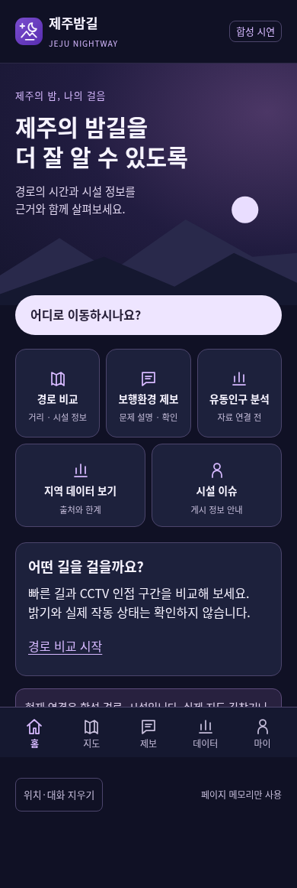
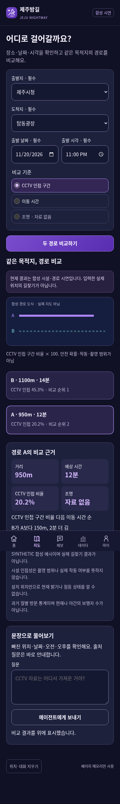

# 제주밤길 웹앱과 에이전트 연결

## 결론

제공된 제주밤길 디자인 명세와 화면 보드를 참고해 **홈·경로 비교·보행환경 제보·자료 설명·이번 페이지 제보** 화면을 만들고 기존 API에 연결했습니다. `/app`에서 실행합니다. 실제 지도 서비스가 아닌 로컬 합성 시연입니다. 기존 `/demo`도 유지했습니다.

```bash
.venv/bin/python -m pip install -r requirements-base.txt
.venv/bin/python -m uvicorn agent.api:app --host 127.0.0.1 --port 8000
```

서버를 실행한 기기의 브라우저에서 `http://127.0.0.1:8000/app`을 엽니다. 다른 기기의127.0.0.1은 이 서버가 아닙니다. 공개 배포·원격 접속은 설정하지 않았습니다.

## 지금 할 수 있는 것

| 화면 | 연결한 동작 | 표시하는 한계 |
|---|---|---|
| 홈 | 3+2 메뉴, 하단5탭, 화면 전환 | 합성 시연 표시 |
| 경로 | 공개 예시 출발·도착 선택, 날짜·시각, CCTV/시간 기준, A/B 카드·근거·출처 | 실제 주소 검색·지도 길찾기 아님. 조명 기준은 자료 없음 |
| 문장 질문 | 추가 위치·날짜·오전오후 확인, 출처 설명, 긴급 우선 안내 | 실제 집 주소를 입력하지 않음. 확인된 좌표가 없는 장소는 추가 확인 |
| 제보 | 위치 예시·시설·문제·설명 → 분류 미리보기 → 확인 후 합성 접수번호 | 정확한 시설 핀/GPS 미연결. 질문이 남거나 선택 충돌 시 접수하지 않음 |
| 자료 | 에이전트 출처·기준일·현재 작동 확인 한계 | 월별 방문 통계를 실시간 보행량으로 표시하지 않음 |
| 마이 | 이번 페이지에서 접수한 합성 제보와 검토 대기 | 실제 사용자 인증·영구 보관·검토/게시·시청 전달 없음 |

경로 수치와 순위는 서버 응답을 사용합니다. 지도 도식은 기본 합성A/B일 때만 보이며 실제 좌표나 배경지도가 아닙니다. 다른 파일 엔진·실제 자료 결과에 합성A/B도식을 붙이지 않습니다. 지도 선·카드의 선택은 함께 갱신합니다. 세 계산식의 임시 가중치를 이 기본 화면에 적용하지 않았습니다.

## 연결한 API

- `/agent/conversation`:문장 질문과 날짜·위치 확인, 비교 결과. 페이지 메모리 상태만 주고받습니다.
- `/reports/preview`:시설·문제 자동 후보와 확인 질문. 저장하지 않습니다.
- `/agent/chat`:사용자가 위치 예시·분류를 확인하고 동의한 합성 제보만 접수. 기존 메모리 SQLite 대역에 검토 대기로 저장합니다.

실제 기관 연락·수리 요청을 실행하지 않습니다. 접수 성공은 서버가 `stored`와 접수번호를 반환한 뒤에만 표시합니다. 검토 대기는 시설 변경에 반영하지 않습니다. 실패하면 입력을 유지하고 오류를 표시합니다. 화면의 실제 제출은 서버의 메모리 제보를 생성하므로 미리보기와 구별합니다.

## 위치·입력 보호

집 주소 입력이나 주소 검색은 제공하지 않습니다. 경로 위치·날짜·문장·이번 페이지 접수 화면은 브라우저 메모리만 사용하고 초기화·페이지 이탈·뒤로가기 복원·새로고침 때 지웁니다. 다른 메뉴로 경로 화면을 떠날 때도 경로 위치와 대화를 비웁니다. 미완료 요청은 중단하고 늦은 응답은 무시합니다. 브라우저 저장소·분석 추적·외부 폰트를 사용하지 않습니다.

사용자가 명시적으로 접수한 합성 제보는 경로 위치와 다르게 서버 메모리에 남으며 서버 종료 때 없어집니다. 화면 초기화가 서버에 접수된 제보를 삭제한다는 뜻은 아닙니다. 이 서버는 인증 없는 개발 대역이므로 개인 주소나 실제 제보를 넣거나 외부에 공개하지 않습니다.

## 디자인 반영

공식 이름·밤색 배경·보라 버튼·선택 카드·A보라 실선/B청록 점선·3+2메뉴·5탭·모바일 여백은 제공된 v1.0명세를 반영했습니다. 원문은 `docs/design/JEJU_NIGHTWAY_DESIGN_SOURCE.md`입니다. `tokens.css`·`icons.svg` 원본 파일은 폴더 목록에 없어 명세 값으로 로컬 CSS토큰과 SVG를 구현했습니다. 제공 원본 파일과 동일하다고 주장하지 않습니다. 외부 사진·화면 캡처·PDF는 앱 자산으로 복사하지 않았습니다.

현재 GPS·실제 지도·유동인구 그래프·지역 비교·시설 목록·개인별 처리 이력·관리자 검증/게시·영구 저장은 구현 완료가 아닙니다. 없는 자료나 기능은 설명·자료 없음으로 표시하고 임의 통계를 만들지 않습니다.

## 제공15문장 평가와 보완

PDF에는 ‘AI 보조 초안’과 ‘공개 장소명을 사용한 가상 제보·긴급 상황’이라고 표시돼 있습니다. 사람의 최종 정답이나 실제 민원15건으로 취급하지 않습니다. 입력과 전후 관찰을 `review/received_sentences/`에 별도로 저장했습니다.

- 길찾기 도중 앞을 막고 소리 지르는 위협 문장은 추가 길찾기 질문보다 긴급 안내를 먼저 제공합니다.
- 정상 가로등 언급과 보도 박스가 섞인 문장은 보행로 통행 방해 후보로 미리보기하며 사람의 확인과 위치를 요청합니다.
- 위치를 모르는 보도블록 문제는 위치 단서를 질문합니다. 비상벨은 지원하는 별도 분류가 아니므로 작동 고장으로 임의 확정하지 않습니다.
- 시청에 대신 수리 요청해 달라는 문장은 외부 대리 실행 범위 밖으로 안내하고 제보 저장을 하지 않습니다.
- ‘밤10시 반’의30분을 보존합니다. 오늘/내일 날짜는 기존 사용자 지침대로 명시 확인하며 현재 시각으로 조용히 확정하지 않습니다. PDF의 ‘추가 질문 없음’ 제안보다 기존 날짜 확인 정책을 우선했습니다.
- 추가 질문에 장소명만 답하면 기존 출발지를 덮어쓰지 않고 물어본 도착 위치를 채웁니다.

명세에서 언급한 제주목 관아·용두암의 좌표를 임의로 추가하지 않았습니다. 현재 장소 선택은 기존 공개 예시4곳이며 정확한 장소·입구 검색은 후속입니다. 모든 문장을 원하는 실제 경로 결과까지 처리했다고 표시하지 않습니다.

## 검사

Python259개 통과, 의존성 사용 중단 예정 경고1개. 제공15문장 전후 관찰은 모두 정상 HTTP응답이지만 의미 정확도나 만족도 수치로 계산하지 않았습니다. Node 페이지 상태5검사 통과.

실제 설치 Chromium에서320·390·430폭×5화면 좌우 넘침 없음, 경로 비교·기준별 순위 변경·지도/카드 선택 동기화·실패 입력 유지·긴급 위치 초기화·제보 미리보기와 합성 접수·모호 제보 접수 차단·뒤로가기/새로고침 초기화·브라우저 저장소 없음 확인. 외부 요청0·JavaScript오류0. 검사 서버는 로컬 임시포트로 실행하고 종료했습니다.

```bash
.venv/bin/python -m pip install -r requirements-browser-test.txt
.venv/bin/python tests/browser/run_nightway_smoke.py
```

센터 실기기·실제GPS·실제 지도·공개 배포·실제 기관 전달 검사는 하지 않았습니다.

## 실제 연결 화면




